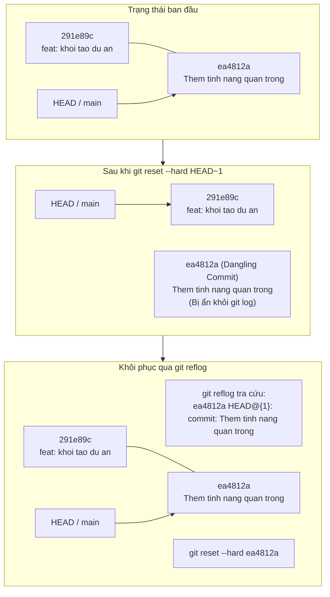

# BÀI TẬP 1: KHÔI PHỤC COMMIT ĐÃ MẤT BẰNG GIT REFLOG

**Mã bài tập:** SESSION 05 - EXERCISE 1 (`homework/session_05/ex1/`)  
**Môn học:** IT215 - Cloud Infrastructure & DevOps Fundamentals  
**Học viên:** Trần Đức Anh (`TranDucAnh3103`)  
**Email:** `TranDucAnh3103@users.noreply.github.com`  
**Hệ điều hành / Môi trường:** Windows 11 Single Language (26H2) / PowerShell 7+ / Git for Windows v2.47+  
**Đường dẫn thư mục dự án:** `f:/CNTT/Rikkei/IT215/ss05/ex1/`  

---

## 1. MỤC TIÊU BÀI TẬP

1. **Hiểu bản chất cơ chế lưu trữ của Git Reflog:** Nắm vững cách Git ghi nhận mọi sự dịch chuyển của con trỏ `HEAD` và các nhánh cục bộ vào nhật ký tham chiếu (Reference Logs - Reflog) độc lập với đồ thị lịch sử commit chính thức (`git log`).
2. **Truy vết tham chiếu commit bị thất lạc:** Sử dụng thành thạo lệnh `git reflog` để dò tìm các commit hash bị "mồ côi" (dangling / unreachable commit) sau khi thực hiện các thao tác nguy hiểm.
3. **Khôi phục trạng thái làm việc sau thao tác `git reset --hard`:** Khôi phục thành công mã nguồn và commit đã bị biến mất khỏi nhánh làm việc mà không cần viết lại code thủ công.
4. **Phân biệt phạm vi tác động của Reflog:** Hiểu rõ Reflog chỉ tồn tại ở máy trạm cục bộ (local-only), không bao giờ được đẩy lên remote repository (`git push`), và có chu kỳ dọn rác (Garbage Collection) mặc định.

---

## 2. BẢNG TỔNG HỢP TIẾN TRÌNH THỰC HIỆN & KẾT QUẢ KIỂM TRA

| STT | Bước thực hiện | Lệnh Git thực thi | Trạng thái HEAD | Kết quả mong đợi | Kết quả thực tế | Trạng thái |
| :---: | :--- | :--- | :---: | :--- | :--- | :---: |
| 1 | Khởi tạo repo & cấu hình danh tính | `git init -b main`<br/>`git config --local user.name ...` | Root commit | Khởi tạo repository rỗng, cấu hình tác giả | `Initialized empty Git repository...` | **PASSED** |
| 2 | Tạo commit khởi tạo ban đầu | `git add init.txt`<br/>`git commit -m "feat: khoi tao..."` | `291e89c` | Tạo commit nền tảng cho nhánh `main` | `[main (root-commit) 291e89c]` | **PASSED** |
| 3 | Tạo tính năng quan trọng | `git add feature.txt`<br/>`git commit -m "Them tinh nang..."` | `ea4812a` | Tạo commit tính năng chứa `feature.txt` | `[main ea4812a] Them tinh nang quan trong` | **PASSED** |
| 4 | Kiểm tra lịch sử ban đầu | `git log --oneline` | `ea4812a` | Hiển thị đầy đủ 2 commit | `ea4812a Them tinh nang quan trong`<br/>`291e89c feat: khoi tao du an ban dau` | **PASSED** |
| 5 | Giả lập sự cố mất commit | `git reset --hard HEAD~1` | `291e89c` | Lùi commit, xóa sạch `feature.txt` khỏi WD | `HEAD is now at 291e89c feat: khoi tao...`<br/>`feature.txt` bị xóa | **PASSED** |
| 6 | Xác nhận commit biến mất | `git log --oneline` | `291e89c` | Chỉ còn 1 commit, mất dấu `ea4812a` | `291e89c feat: khoi tao du an ban dau` | **PASSED** |
| 7 | Tra cứu dấu vết bằng Reflog | `git reflog` | Tham chiếu | Tìm thấy mã hash và mô tả của `HEAD@{1}` | `ea4812a HEAD@{1}: commit: Them tinh nang quan trong` | **PASSED** |
| 8 | Khôi phục commit đã mất | `git reset --hard ea4812a` | `ea4812a` | Di chuyển HEAD về commit cũ, khôi phục file | `HEAD is now at ea4812a Them tinh nang...` | **PASSED** |
| 9 | Kiểm tra tính toàn vẹn dữ liệu | `git log --oneline`<br/>`Get-Content feature.txt` | `ea4812a` | Commit xuất hiện lại, nội dung tệp đầy đủ | Khôi phục nguyên vẹn: `"Day la tinh nang quan trong"` | **PASSED** |

---

## 3. CƠ CHẾ HOẠT ĐỘNG CỦA GIT REFLOG VÀ CÁC TRẠNG THÁI CON TRỎ

### 3.1. So sánh `git log` và `git reflog`

| Đặc tính so sánh | `git log` | `git reflog` |
| :--- | :--- | :--- |
| **Bản chất** | Duyệt theo đồ thị cha-con (Commit DAG) từ đỉnh nhánh hiện tại ngược về quá khứ. | Nhật ký tuần tự ghi nhận mọi thao tác làm thay đổi con trỏ `HEAD` hoặc nhánh cục bộ. |
| **Dangling Commits** | **Không hiển thị** các commit bị mồ côi (không còn nhánh nào trỏ tới). | **Hiển thị đầy đủ** mọi commit từng được trỏ bởi `HEAD` trong vòng đời lưu trữ. |
| **Phạm vi lưu trữ** | Thuộc về cấu trúc dữ liệu commit, được đồng bộ qua `git push`/`git pull`. | Thuộc về máy trạm cục bộ (Local-only, nằm tại `.git/logs/`), không bao giờ đẩy lên remote. |
| **Thời gian tồn tại** | Vĩnh viễn (trừ khi bị rebase/filter-repo xóa bỏ). | Mặc định 90 ngày cho commit có thể tiếp cận, 30 ngày cho unreachable commit (`gc.reflogExpire`). |

### 3.2. Sơ đồ chu trình mất và khôi phục commit



---

## 4. CHI TIẾT CÁC BƯỚC THỰC HIỆN VÀ MINH CHỨNG THỰC TẾ

### Bước 1: Khởi tạo Local Repository và thiết lập danh tính tác giả

Khởi tạo kho lưu trữ Git cục bộ với nhánh mặc định là `main`, cấu hình thông tin cá nhân ở phạm vi `--local` để không ảnh hưởng cấu hình toàn cục:

```powershell
# Di chuyển đến thư mục bài tập
cd f:\CNTT\Rikkei\IT215\ss05\ex1

# Khởi tạo repo
git init -b main

# Thiết lập danh tính cục bộ
git config --local user.name "TranDucAnh3103"
git config --local user.email "TranDucAnh3103@users.noreply.github.com"
git config --local core.autocrlf false
```

**Kết quả ghi nhận:**
```text
Initialized empty Git repository in F:/CNTT/Rikkei/IT215/ss05/ex1/.git/
```

---

### Bước 2: Tạo commit ban đầu và commit tính năng quan trọng

Tạo tệp `init.txt` làm mốc lịch sử gốc, sau đó tạo tệp `feature.txt` chứa nội dung nghiệp vụ quan trọng:

```powershell
# Tạo commit gốc
"Du an khoi tao ban dau" | Out-File -FilePath "init.txt" -Encoding utf8
git add init.txt
git commit -m "feat: khoi tao du an ban dau"

# Tạo tệp tính năng nghiệp vụ quan trọng
"Day la tinh nang quan trong" | Out-File -FilePath "feature.txt" -Encoding utf8
git add feature.txt
git commit -m "Them tinh nang quan trong"
```

**Kết quả ghi nhận:**
```text
[main (root-commit) 291e89c] feat: khoi tao du an ban dau
 1 file changed, 1 insertion(+)
 create mode 100644 init.txt
[main ea4812a] Them tinh nang quan trong
 1 file changed, 1 insertion(+)
 create mode 100644 feature.txt
```

Kiểm tra lịch sử commit hiện tại bằng `git log --oneline`:
```text
ea4812a Them tinh nang quan trong
291e89c feat: khoi tao du an ban dau
```

---

### Bước 3: Giả lập sự cố mất commit bằng `git reset --hard HEAD~1`

Người phát triển vô tình thực thi lệnh `reset --hard` lùi về commit trước đó:

```powershell
git reset --hard HEAD~1
```

**Kết quả ghi nhận:**
```text
HEAD is now at 291e89c feat: khoi tao du an ban dau
```

Kiểm tra lại lịch sử commit và kiểm tra sự tồn tại của tệp `feature.txt`:
```powershell
git log --oneline
Test-Path feature.txt
```

**Kết quả ghi nhận:**
```text
291e89c feat: khoi tao du an ban dau
False
```

> [!WARNING]
> Tại thời điểm này, commit `ea4812a` đã hoàn toàn biến mất khỏi `git log`. Tệp tin `feature.txt` cũng bị xóa sạch khỏi Working Directory và Staging Area. Nếu nhìn bằng mắt thường hoặc dùng các lệnh Git thông thường, commit này tưởng chừng đã bị xóa vĩnh viễn.

---

### Bước 4: Truy vết con trỏ bằng `git reflog`

Git không xóa ngay lập tức commit object trong cơ sở dữ liệu đối tượng (`.git/objects/`). Mọi thay đổi của con trỏ `HEAD` đều được ghi lại trong nhật ký Reflog:

```powershell
git reflog
```

**Kết quả ghi nhận từ terminal:**
```text
291e89c HEAD@{0}: reset: moving to HEAD~1
ea4812a HEAD@{1}: commit: Them tinh nang quan trong
291e89c HEAD@{2}: commit (initial): feat: khoi tao du an ban dau
```

**Phân tích bản ghi Reflog:**
- `HEAD@{0}`: Hành động gần nhất là lệnh `reset: moving to HEAD~1`, khiến `HEAD` trỏ về `291e89c`.
- `HEAD@{1}`: Trạng thái ngay trước khi thực hiện reset chính là commit `ea4812a` với thông điệp `"Them tinh nang quan trong"`.
- Mã SHA-1 hash của commit cần khôi phục là: `ea4812a`.

---

### Bước 5: Khôi phục commit thành công

Sử dụng lệnh `git reset --hard` kết hợp với mã hash vừa tìm được từ Reflog để đưa con trỏ `HEAD` và nhánh `main` quay trở lại commit mong muốn:

```powershell
git reset --hard ea4812a
```

**Kết quả ghi nhận:**
```text
HEAD is now at ea4812a Them tinh nang quan trong
```

---

### Bước 6: Thẩm định và xác minh kết quả khôi phục

Kiểm tra lại toàn bộ trạng thái để xác nhận:
1. Lịch sử commit trong `git log --oneline` đã hiển thị lại commit `ea4812a`.
2. Tệp `feature.txt` đã xuất hiện trở lại trong Working Directory với đầy đủ nội dung nguyên vẹn.
3. Trạng thái repository hoàn toàn sạch sẽ (`clean`).

```powershell
git log --oneline
Get-Content feature.txt
git status
```

**Kết quả ghi nhận thực tế:**
```text
ea4812a Them tinh nang quan trong
291e89c feat: khoi tao du an ban dau

Day la tinh nang quan trong

On branch main
nothing to commit, working tree clean
```

---

## 5. CÁC PHƯƠNG PHÁP KHÔI PHỤC THAY THẾ KHI SỬ DỤNG REFLOG

Tùy vào tình huống thực tế trong dự án, kỹ sư có thể lựa chọn 1 trong 3 giải pháp khôi phục sau khi đã tìm ra commit hash từ Reflog:

1. **Phương pháp 1: `git reset --hard <hash>` (Cách áp dụng trong bài)**
   - *Ưu điểm:* Nhanh chóng, đưa ngay nhánh hiện tại về đúng trạng thái commit đó.
   - *Lưu ý:* Ghi đè toàn bộ Working Directory hiện tại, chỉ dùng khi không có thay đổi dở dang chưa commit.
2. **Phương pháp 2: `git checkout -b <new-branch> <hash>` (Khuyên dùng khi muốn an toàn)**
   - *Ưu điểm:* Tạo hẳn một nhánh mới bắt đầu từ commit bị mất, không làm xáo trộn nhánh hiện tại. Cho phép kiểm tra code trước khi quyết định merge hoặc đổi tên nhánh.
   - *Lệnh:* `git checkout -b restore-feature ea4812a`
3. **Phương pháp 3: `git cherry-pick <hash>`**
   - *Ưu điểm:* Nhặt riêng commit bị thất lạc và áp dụng đè lên đầu nhánh hiện tại dưới dạng một commit mới.
   - *Lệnh:* `git cherry-pick ea4812a`

---

## 6. BÀI HỌC KINH NGHIỆM & QUY TẮC AN TOÀN TRONG SẢN XUẤT

> [!TIP]
> - **Nguyên tắc "Git hầu như không bao giờ thực sự xóa dữ liệu":** Bất kỳ nội dung nào đã từng được commit đều tồn tại dưới dạng loose object trong `.git/objects/` ít nhất từ 30 đến 90 ngày trước khi tiến trình dọn rác tự động `git gc` (Garbage Collection) kích hoạt.
> - **Khi lỡ tay chạy nhầm lệnh nguy hiểm (`reset --hard`, `rebase -i`, `branch -D`):** Việc đầu tiên cần làm là **bình tĩnh, không chạy thêm các thao tác sửa chữa vội vã**, ngay lập tức mở `git reflog` để tìm lại snapshot trước đó.
> - **Reflog không bảo vệ code chưa commit:** Nếu thay đổi chỉ mới nằm ở Working Directory mà chưa qua `git add` hay `git commit`, lệnh `git reset --hard` sẽ xóa vĩnh viễn thay đổi đó mà Reflog không thể cứu được.
